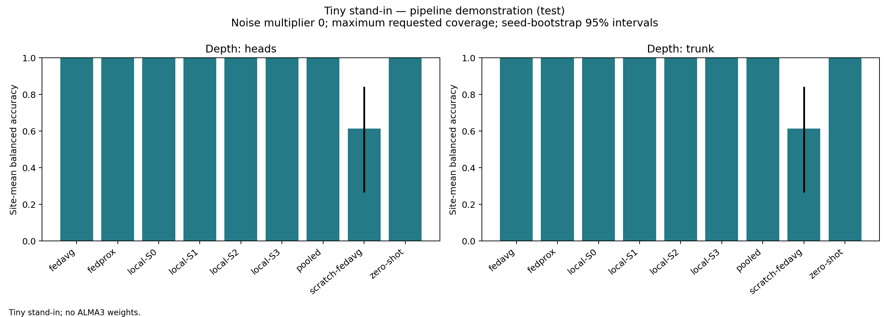
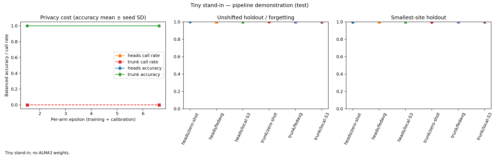
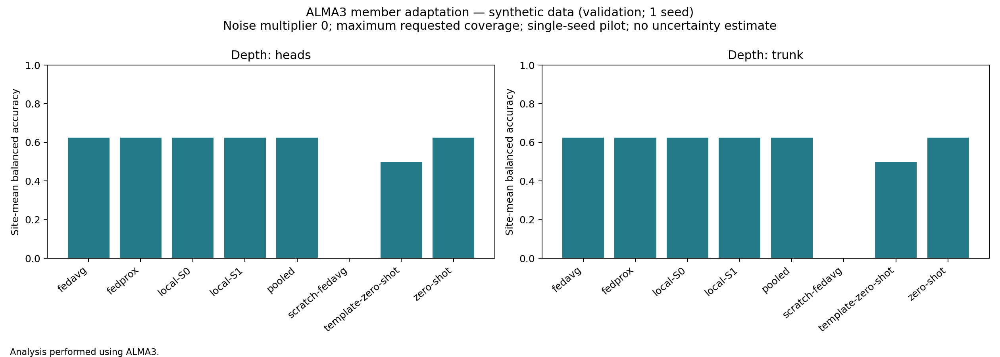
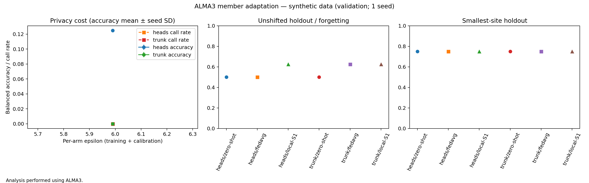
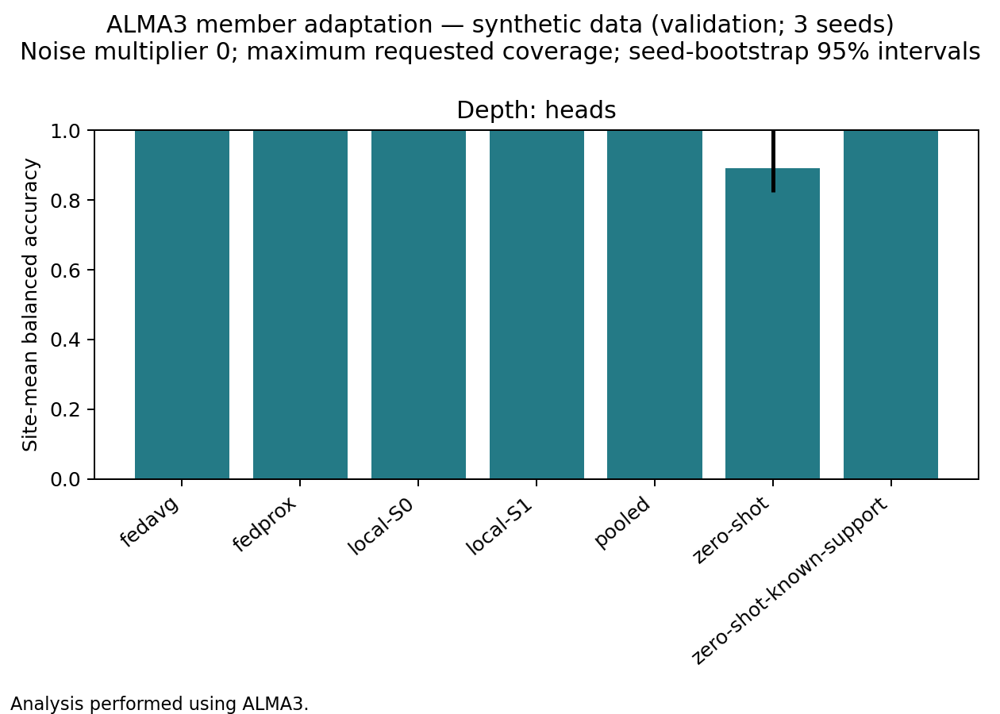
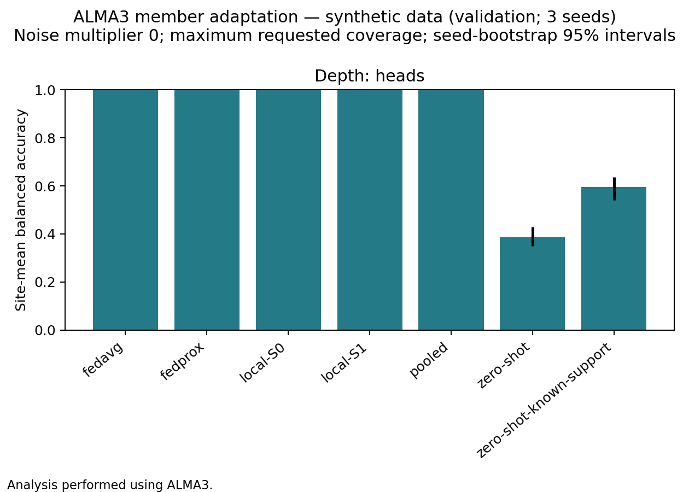
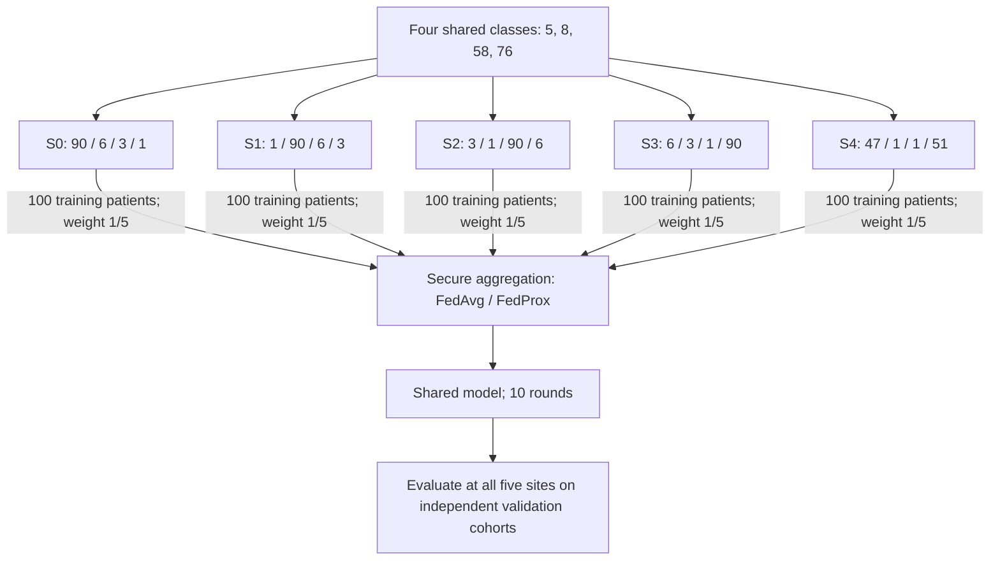
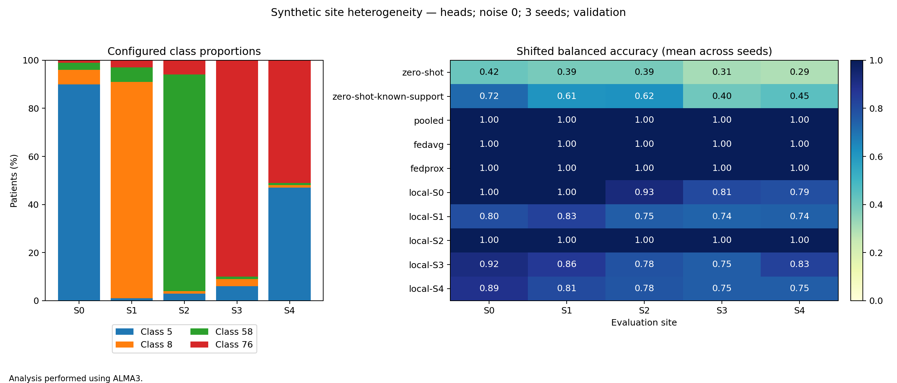

# ALMA3 federated fine-tuning — inspection and implementation proposal

Research prototype on synthetic cohorts; not a clinical validation.
Analysis performed using ALMA3.

## Inspection record (2026-11-11)

Suite base: `origin/main` at `3b4fc6c`. Inspected upstream tag `v3.1.2`,
resolved commit `e5be9e37b04244bb55290a1841f7e0b2796fe24b`, in a separate
unmodified checkout. No release weights were downloaded or evaluated.

Sources: [upstream source](https://github.com/almagx/alma3/tree/v3.1.2),
especially `src/alma3/{release,final_ensemble,dx,terminal}.py`, `Dockerfile`,
`pyproject.toml`, and `LICENSE`.

### Input and release structure

The release validator requires an ordered 387,849-CpG reference, 109 terminal
classes, taxonomy, member configurations and safetensors, template tensors,
optional residual heads and partitions, reporting thresholds, license, checksum
inventory and completion marker. Inputs are five matching `[batch, CpG]` tensors:
beta values, Boolean observation masks, uncertainty, integer chromosome IDs and
floating-point positions. Observed beta values must be finite and in [0, 1].
The reference ordering must be preserved; selecting a new variable-CpG panel
with the existing methylation preprocessing would violate this contract.

The final ten-member ensemble mixes neural terminal probabilities and a sparse
template classifier. Neural members expose trainable direct-CpG projections,
trunks, taxonomy-aware heads, and optional refinement/direct-evidence modules.
Some members also have learned residual heads. The inference loader freezes
parameters; training must explicitly select parameters on separately loaded
models. The template member holds buffers, not gradient-trained parameters.
Training should call neural modules with autograd, not the inference prediction
wrapper, while retaining the release ensemble's probability transformations.

Important version distinction: runtime tag v3.1.2 still validates a release
metadata version of `3.1.0`. Do not rewrite that metadata or its hashes.

### Two integration decisions requiring the brief's check-in

1. **Dependency isolation.** Upstream pins Torch 2.14.1; this suite pins 2.8.0.
   The upstream Dockerfile explicitly installs CPU-only Torch. Proposed approach:
   retain suite pins and run ALMA3 training in a separate, explicitly versioned
   runtime, exchanging model updates and aggregate statistics with the suite's
   APPFL driver. A GPU runtime needs separate verification. Do not install
   ALMA3 dependencies into the suite environment or patch upstream code.
2. **Calibration semantics.** Although `dx.py` contains precision-floor
   calibration contracts, the actual final-ensemble release reporting validator
   requires `fixed_subtype_only_v1`, a minimum 5,000 observed CpGs, zero cutoffs
   above subtype, and a fixed subtype cutoff. Proposed federated precision-floor
   recalibration is therefore an explicitly new research policy, stored outside
   the release. It must not be described as preserving certified release behavior
   or guaranteeing population precision from finite validation counts.

### Proposed implementation after check-in

Extend the existing methylation experiment and its metrics, manifests and plotting.
Use head-only and head-plus-trunk fine-tuning, with optional full-depth training
only after resource measurement. Compare zero-shot, each local site, pooled,
APPFL FedAvg, FedProx, and matched randomly initialized neural models. Preserve
the native ensemble as a separate zero-shot reference. Record trainable counts,
wire bytes, compute, member selection and every initialization choice.

Template `means` and `group_index` are consumed by `SparseTemplates`, making
profile-anchored synthetic cohorts plausible. Viability is not demonstrated
until the real bundle is inspected and zero-shot validation scores are measured.
Generate site-specific batch shifts, label skew, missingness/coverage and subtype
perturbations while keeping the ordered panel. Include an unshifted holdout for
forgetting, and report smallest-site performance. Because the generator would
reuse template profiles, compare neural-only and template-inclusive predictions
and disclose the resulting template advantage; do not treat this as independent
evidence of ALMA3's generalization.

Use site-local validation sufficient statistics for hierarchical, coverage-aware
recalibration. Reuse the fine-mapping secure-aggregation protocol concepts
(fixed roster, pairwise masks, context binding, fixed-point bounds), adapting
its domain-specific tensor layout to model updates and calibration counts.
Specify patient-level adjacency and account for every private training and
calibration release when reporting epsilon and delta. Secure aggregation alone
does not provide differential privacy. Single-process isolation illustrates the
protocol; it does not protect against the machine's operator.

All model/configuration selection uses validation only. Freeze the selected
configuration and calibration before a single test evaluation. Repeat across
prespecified seeds and privacy budgets; report paired uncertainty. Tests use
tiny stand-ins and require neither weights nor upstream runtime installation.
Derived checkpoints live outside the immutable release and version control,
carry its license and explicitly state that they are based on ALMA3.

## Runs

At the initial check-in, no training or inference had run. The completed and
pilot runs are recorded below. GPU-hour estimates still require a representative
GPU benchmark before requesting a large multi-member run.

## Citation

ALMA Genomics Inc. (2026). ALMA3 (Version 3.1.2).
https://github.com/almagx/alma3

## Implemented workflow

The user's check-in approved dependency isolation and a new research calibration
policy. Implementation lives in `experiments/methylation/alma3/`, reuses the
existing methylation metrics and JSON artifact writer, and uses APPFL's
`FedAvgAggregator`. It does not change the existing from-scratch experiment.

`heads` updates taxonomy heads and any residual head; `trunk` additionally updates
the trunk; `full` updates all parameters. The default comparison adapts one
explicitly named released neural member, retaining its probability transforms.
This is not a fine-tuned ten-member ensemble. The random-start comparison resets
**all** trainable parameters and trains at full depth, including when its paired
pretrained arm trains only heads. Parameter counts and communication make this
capacity/compute difference visible. Every training arm uses full-batch clipped
SGD, one full-data step per `local_steps`, resetting the optimizer each round.
Dropout is disabled, so each patient's clipped gradient is independent of other
patients. FedProx adds the data-independent proximal gradient after clipping/noise.

Actual release runs automatically include the frozen template-only reference.
Set `release_ensemble: true` to additionally evaluate the frozen ten-member
ensemble with its native certified BF16/batch-64 prediction path. That option
loads all members and needs a separate resource estimate before a large study.
The adapted member runs FP32; neither it nor the recalibrated policy is certified
release inference. Terminal metrics use terminal argmax, while hierarchical
call metrics use ALMA3's type-first paths and conditional ancestor/joint subtype
scores. These are deliberately identified as different decision summaries.

### Run the stand-in comparison

In the suite's Python 3.12 environment with `[methylation,dev]` installed:

```bash
python -m appfl_bio_suite.experiments.methylation.alma3 run \
  --fixture --validation-only \
  --config src/appfl_bio_suite/experiments/methylation/configs/alma3-standin.json \
  --out local/output/alma3-standin-validation
```

The JSON preset covers three seeds, two adaptation depths, no privacy plus two
noise settings, four unequal sites, and two coverage conditions. All figures
from this command explicitly say **tiny stand-in**. Its analytic prototype
weights are not ALMA3 and cannot support a pretrained ALMA3 performance claim.

After validation-only development, choose and rerun the final configuration if
necessary. Freeze the completed comparison and evaluate its checkpoints once:

```bash
python -m appfl_bio_suite.experiments.methylation.alma3 freeze \
  local/output/alma3-standin-validation
python -m appfl_bio_suite.experiments.methylation.alma3 evaluate \
  local/output/alma3-standin-validation/frozen.json \
  --out local/output/alma3-standin-test
```

Freezing binds configurations, identities, selected checkpoints, policies and
validation results by SHA-256. Evaluation verifies them and the worker identity,
then uses an exclusive `TEST_STARTED` marker. It never retrains or recalibrates.
An interrupted evaluation remains marked as inspected. The guard prevents
accidental repeated test evaluation through this CLI, not a user deliberately
copying/deleting artifacts. Do not bypass it to select results. Calibration,
validation scoring and test use distinct synthetic patient streams. Validation
mode neither generates nor predicts test patients.

### Released weights and isolated runtime

The suite's Torch pin remains unchanged. Use the upstream runtime tag v3.1.2
(commit `e5be9e37b04244bb55290a1841f7e0b2796fe24b`) in a separate environment.
An Apptainer definition adds only the dependencies needed for the suite's metrics;
it preserves the release and validates its hashes:

```bash
apptainer build alma3-research-3.1.2.sif scripts/methylation/alma3-runtime.def
export ALMA3_SIF="$PWD/alma3-research-3.1.2.sif"
export ALMA3_SUITE_SOURCE="$PWD/src"
python -m appfl_bio_suite.experiments.methylation.alma3 run \
  --validation-only --config your-prespecified-study.json \
  --release /opt/alma3/release --member 'CV:e11' \
  --worker-command "$PWD/scripts/methylation/alma3-worker.sh" \
  --out local/output/alma3-member-validation
```

The `/opt/alma3/release` path above is inside the worker's container. The shared
worktree/output paths must be visible at the same absolute locations in both
processes; add site-specific bind mounts to a local wrapper if necessary. The
shipped image has CPU-only Torch. Merely adding `--nv` does not provide CUDA;
a GPU build requires its own pinned runtime validation and resource check-in.

Without Apptainer, `scripts/methylation/fetch_alma3_release.py DESTINATION` can
extract the immutable release into a **new directory outside the repository**.
It fetches the pinned 4.07 GB OCI release layer, verifies its digest and every
release checksum, and rejects nonregular/escaping archive paths. The layer hash
is `d9d0336ded9042c7e09c0bed53168680adac170526c9327c884e11e9f32ecb6d`.
Use a separate Python 3.12 virtual environment with Torch 2.14.1, NumPy 1.26.4,
safetensors 0.8.0, scikit-learn 1.7.2 and SciPy 1.16.2; install the pinned upstream
checkout with `--no-deps`. Pass its Python executable as `--worker-command` and
set `PYTHONPATH` to this worktree's `src`. Do not pip-install the suite into that
environment, which would resolve conflicting Torch pins. The worker does not
import APPFL. The coordinator retains APPFL and the suite's own environment.

The loader verifies every release hash and never writes inside the release.
Only selected trainable tensors cross the worker boundary; frozen pretrained
weights stay in the worker. Derivative checkpoint bundles include
`LICENSE.ALMA3` and `ATTRIBUTION.txt`; distribute those with their checkpoints,
configuration, member identity and source-release fingerprint. Checkpoints,
release layers and images are ignored by Git. Reports include the required
attribution. Do not represent the derivative as endorsed by ALMA Genomics.

### Synthetic data and privacy interpretation

Profiles come from the release's `SparseTemplates` means in its original terminal
and CpG order. The generator adds within-class beta variation, persistent
site-specific logit shifts, Dirichlet label skew with nonzero class support,
site-dependent coverage, and class-specific perturbations on a small probe block.
The unshifted holdout removes the site shift and class perturbation and restores
the requested coverage. All records are independent synthetic patients; there
are no repeated patient samples. The smallest site is identified from actual
configured sizes, not a hard-coded hospital number.

This generator intentionally privileges the released templates. Compare the
neural-member zero-shot and adaptation arms with the template-only reference;
do not pool those scores into a claim about clinical generalization. The
perturbation strength must be selected using validation only. A real-weight
pilot must establish whether the chosen cohorts are recognized zero-shot and
whether there is a recoverable shift; the code does not assume that outcome.

DP uses fixed public site sizes and **replace-one patient** adjacency. Each
full-batch clipped gradient sum has sensitivity `2 * clip_norm`; Gaussian noise
has standard deviation `2 * clip_norm * sigma`. A step consumes
`rho = 1 / (2 * sigma**2)` zCDP, without subsampling amplification.
For each coverage and hierarchy level, the worker returns only a histogram of
correct/incorrect confidence bins. Prior-level gates are applied locally before
the next query. Each histogram has sensitivity `sqrt(2)` and is independently
noised with standard deviation `sqrt(2) * sigma` at each site before masking.
The coordinator chooses the lowest supported threshold whose conservative
Wilson bound meets the requested floor, with simultaneous Gaussian tail margins
for noisy counts. Insufficient support produces explicit abstention (`1.01`).
Small private validation cohorts will often abstain completely.

Training and calibration patients are disjoint, so their budgets compose by
maximum; levels and coverage queries compose sequentially. Epsilon is reported
using `rho + 2 * sqrt(rho * log(1/delta))`. Each arm has its own budget; the
manifest also conservatively sums over every released private arm/seed/depth.
Nonprivate reference arms and public synthetic evaluation mean the **whole
comparison is not a DP release**. A future private-data study must budget
model selection and metrics as well; this implementation accepts generated
synthetic cohorts only. Noise seeds are independent of published data seeds.
The Gaussian sampler uses a separately entropy-seeded Torch PRNG, not a hardened
cryptographic DP implementation.

Secure aggregation specializes the fine-mapping `pairwise-u64-v1` wire format,
including fresh round contexts, pairwise confirmations, fixed-point overflow
checks and a complete fixed roster. Worker masks match the existing shipped
`mask_moments` bit-for-bit in tests; the coordinator reuses `pool_secure_payloads`.
In secure mode, APPFL receives a single virtual client containing the masked
sample-weighted sum. Training communication counts downlink trainable tensors
and uplink masked tensors/manifests; calibration communication is separate.
It excludes release provisioning, key exchange and transport envelopes.
`training_seconds` is inclusive worker update wall time (state loading,
optimization, masking and serialization), not isolated GPU compute time. Local
and pooled arms do not incur federated model-update traffic. The simulation's
operator owns all worker memory and secrets; this is not a deployed security
boundary and supports no dropout recovery.

## Verification and artifacts

Tests use only tiny stand-ins: mask parity, weighted APPFL equivalence, missing
roster/context rejection, fixed-point range errors, parameter freezing,
FedProx behavior, privacy accounting, independent DP noise, hierarchical
calibration/abstention, validation/test separation, frozen-artifact tamper
rejection and one-time test evaluation. Run:

```bash
pytest tests/test_methylation_alma3.py tests/test_methylation.py \
  tests/test_fine_mapping_secure_aggregation.py
```

Every completed study writes configuration/identity/manifests, checkpoints,
calibration policies, per-site/per-coverage metrics, parameter/communication
counts, seed summaries and paired differences. `comparison.png`/`.svg` show
arm comparisons; `privacy-forgetting-smallest.png` covers privacy cost,
unshifted performance and the smallest site. Intervals bootstrap seeds and
are only descriptive with three seeds, not clinical confidence intervals.

Accounting reference: Bun and Steinke, *Concentrated Differential Privacy:
Simplifications, Extensions, and Lower Bounds* (2016),
https://arxiv.org/abs/1605.02065. Heterogeneity reference: Li et al.,
*Federated Optimization in Heterogeneous Networks* (MLSys 2020),
https://proceedings.mlsys.org/paper/2020/file/1f5fe83998a09396ebe6477d9475ba0c-Paper.pdf.

## Measured run record — 2026-11-11

### Three-seed stand-in study, completed

`alma3-standin.json`, seeds 42–44, 162 arm/seed/depth/noise combinations. The
validation study was frozen without altering the preset and its test cohort was
evaluated once. Frozen artifact SHA-256:
`ac5c9a5c737e848b4af2a885ef1865800214c29d752488c9fa4f055e900c4538`.
Outputs are in `local/output/alma3-standin-validation` and
`local/output/alma3-standin-test` (ignored run artifacts).

At maximum requested coverage, test site-mean balanced accuracy, mean ± sample
SD over three seeds, for the nonprivate arms:

| Arm | Heads | Heads + trunk |
| --- | ---: | ---: |
| Analytic zero-shot stand-in | 1.000 ± 0.000 | 1.000 ± 0.000 |
| Pooled | 1.000 ± 0.000 | 1.000 ± 0.000 |
| FedAvg | 1.000 ± 0.000 | 1.000 ± 0.000 |
| Full random-start FedAvg | 0.614 ± 0.307 | 0.614 ± 0.307 |

**Interpretation:** this fixture is saturated and shows no fine-tuning gain.
It checks pipeline execution, privacy costs, aggregation, reporting and test
separation. Its initialization advantage is engineered and is not evidence
about ALMA3. Do not present this table as a hospital-network benefit.

For trained private arms, noise multipliers 2 and 8 yield conservative per-arm
ε = 6.627 and 1.516 respectively at δ = 10⁻⁵, including calibration accounting.
Both private settings abstained on every scored stand-in patient after
recalibration, versus a call rate of 1.0 without noise. The apparent absence of
classification-accuracy cost therefore does not imply useful private reporting.

Secure FedAvg training traffic is 14,040 bytes for heads and 36,504 bytes for
heads + trunk, plus 7,184 calibration bytes, per seed/noise arm. These are tiny
model tensor/protocol counts, not estimates of ALMA3 network traffic.





### Released-weight pilot

The immutable v3.1.2 release layer and all release hashes were verified. A
separate Python 3.12 environment with Torch 2.14.1+cpu and ALMA3 3.1.2 was created
outside the repository; the suite's dependency pins were not changed.
The selected member is `CV:e11`. The pilot configuration has seed 42, two sites
with 3 and 2 training patients, four patients per site in each calibration and
validation fold, one round/step, 25% requested coverage, two depths and noise
multipliers 0 and 2. With one local step, FedProx equals FedAvg by
construction; heterogeneity-robust behavior needs multiple local steps. It is strictly validation-only and far too small to assess
clinical or generalization performance.

An initial pilot was interrupted after its first completed arm to add bounded
worker-local caches for repeated inputs/predictions. Its first zero-shot member
arm had 0.625 site-mean terminal balanced accuracy on eight shifted validation
patients and 0.500 on the unshifted counterpart. Its hierarchical calibration
abstained at every level because eight calibration patients cannot establish a
0.90 precision floor with the required evidence. Partial artifacts remain in
`local/output/alma3-release-smoke-validation`; they are not a completed study.
The cached restart (`local/output/alma3-release-smoke-cached-validation`)
completed zero-shot and pooled arms before exposing a scalar-tensor conversion
bug in secure aggregation. ALMA3 cosine heads have a scalar `log_scale` that the
original matrix-only protocol had not exercised. Both site masking and pooled
decoding now preserve zero-dimensional arrays; regression tests cover scalar
wire parity and weighted APPFL aggregation, including preservation of FP64
residual-head parameters. The corrected pilot uses
`local/output/alma3-release-validation`. That attempt completed four arms before
profiling identified host huge-page compaction in large NumPy masking allocations.
The CLI now defaults `NUMPY_MADVISE_HUGEPAGE=0` before importing NumPy, and the
isolated worker explicitly uses that setting. Masking also avoids unnecessary
full-size copies while retaining byte-for-byte protocol compatibility. For
programmatic use, set the environment variable before importing NumPy. These
are per-process settings; no host configuration was changed. The final pilot
uses `local/output/alma3-release-pilot-validation`. No interrupted run touched test.

### Verification environment

The eight new tests and 60 existing methylation/secure-aggregation tests passed
on Python 3.12.11 with APPFL 1.10.0 in the available coordinator environment.
That environment contains Torch 2.11.0+cu130, so this is **not** a validation of
the suite's canonical Torch 2.8.0 installation; CI retains the suite's exact
constraints and needs no ALMA3 package or weights. Repository-wide Ruff lint and
format checks passed. The released-weight worker uses its separate required
Torch 2.14.1+cpu environment. No GPU jobs or large multi-member studies were run.

### Corrected released-weight pilot, completed

All **32 arms** completed in `local/output/alma3-release-pilot-validation` using
`configs/alma3-release-pilot.json`. This run remains **validation-only**; the
ALMA3 test cohorts have never been generated or evaluated. Eight shifted
validation patients, site-mean terminal balanced accuracy:

| Arm | Heads, no noise | Heads + trunk, no noise | Heads, σ=2 | Heads + trunk, σ=2 |
| --- | ---: | ---: | ---: | ---: |
| Released CV:e11, zero-shot | 0.625 | 0.625 | 0.625 | 0.625 |
| Pooled | 0.625 | 0.625 | 0.250 | 0.000 |
| FedAvg | 0.625 | 0.625 | 0.125 | 0.000 |
| FedProx | 0.625 | 0.625 | 0.125 | 0.000 |
| Full random-start FedAvg | 0.000 | 0.000 | 0.000 | 0.000 |
| Frozen template member | 0.500 | 0.500 | 0.500 | 0.500 |

Zero-shot/template parameters receive no training noise; σ affects their
calibration only. The private arms report ε = 5.990 at δ = 10⁻⁵; the five
hierarchical calibration queries dominate this pilot's budget. Every arm's
calibration abstained at every level. These are one seed and one noise draw per
private arm, with **no uncertainty estimate**. There is **no demonstrated
fine-tuning gain**. The near-zero random-start scores after one step on five
patients do not establish a meaningful generalization advantage.

Trainable blocks contain 146,577 parameters for heads, 641,041 for heads + trunk,
and 99,930,641 for full random-start training. One secure FedAvg round costs
3,518,944 bytes, 15,386,080 bytes and 2,398,336,496 bytes respectively, before
calibration traffic. Zero-shot rows retain the selected neural block size in
`trainable_parameters` metadata, but optimize no parameters; the template
member itself has no trainable parameters.





The implementation and pilot establish that released-weight loading, local and
pooled updates, APPFL aggregation, DP, masking, calibration and reporting execute
together. A larger **prespecified multi-seed ALMA3 study** is still required to
answer the scientific comparison. In particular, the generator has not yet
shown a recoverable site shift: this pilot's shifted zero-shot score exceeded
its unshifted score. Select generator/training settings on validation only,
then freeze before the first real-weight test evaluation. No full-ensemble
fine-tuning or GPU benchmark has been performed, so no GPU-hour estimate for
a nine-member study is claimed.

These development runs used uncommitted worktree changes atop `3b4fc6c`;
`manifest.json`'s suite commit identifies that base, not an immutable release of
this implementation. Data seeds reproduce synthetic cohorts; DP noise is
intentionally not replayed from those published seeds. The run directories
retain the exact checkpoints, configurations and reports for these measurements.

## Shared-support validation follow-up

The five-patient pilot had no overlap between its pooled training labels and
its eight validation labels. To make adaptation measurable, `class_indices`
now restricts the synthetic generator to an explicit subset of the released
109-class taxonomy, and `minimum_per_class` reserves that many patients per
class in **each** site and split. Remaining patients follow the original
site-specific Dirichlet mixture. Labels keep their original taxonomy indices;
the model still predicts all 109 classes. These quotas describe synthetic
cohort construction, not resampling of real patient records. Defaults preserve
the original unrestricted generator.

`arms` optionally selects a named subset of study arms, avoiding unrelated
scratch and privacy runs while developing the shift mechanism. Empty `arms`
retains the full comparison. The follow-up first screens shift severity using
seed 42 validation only, then holds the selected severity fixed across three
data seeds. Seed 42 is therefore a development seed, not an independent
confirmation. No real-weight test cohort is inspected during this selection.

The committed `alma3-shared-support.json` configuration uses taxonomy indices
5, 8, 58 and 76, site training sizes 32 and 16, and 24 patients per site in each
calibration/validation/test fold. Every class has at least three patients in
each fold. The heads-only comparison uses ten rounds, two local steps, learning
rate 0.3, clipping norm 1, no DP noise, and secure aggregation. It compares
zero-shot, pooled, FedAvg, FedProx and both local models. This isolates whether
adaptation works before adding privacy noise or expensive random-start arms.

The initial screen (`local/output/alma3-shared-support-screen/screen.json`)
used the four fixed classes without screening classes for favorable outcomes.
On seed 42, unshifted site-mean balanced accuracy was 1.000. Shift strengths
0, 2, 4, 8 and 12 produced 1.000, 0.823, 0.463, 0.181 and 0.226 respectively.
Strength 2 was selected as the smallest screened shift with a substantial
accuracy reduction. Larger shifts were not used to maximize reported gain.

To repeat the screen in the isolated worker environment:

```bash
NUMPY_MADVISE_HUGEPAGE=0 PYTHONPATH=src "$ALMA3_PYTHON" \
  scripts/methylation/screen_alma3_shift.py \
  --config src/appfl_bio_suite/experiments/methylation/configs/alma3-shared-support.json \
  --release "$ALMA3_RELEASE" --member CV:e11 --out local/output/new-shift-screen
```

Use the same configuration with the standard `run --validation-only` command
for the adaptation comparison. Its default three seeds are 42, 43 and 44.

For compatible heads-only members, the worker caches frozen neural embeddings
for training cohorts in memory. The trainable heads and released probability
transforms are unchanged. Partitioned members, direct-logit-correction members,
trunk/full training and scratch training retain the full forward path. Neither
embeddings nor individual predictions are sent to the coordinator. A real
CV:e11 check on four patients and two FedProx steps found identical batched
predictions and maximum parameter-update discrepancy 1.63e-8 versus uncached
per-patient forwards. A protocol test also verifies cached training gradients.
The first uncached follow-up was stopped after zero-shot and pooled results;
its directory is retained as an incomplete development run. The complete
comparison uses `local/output/alma3-shared-support-cached-validation`.

Unshifted follow-up metrics cover the same four selected classes, so they test
retention within that subset. They do **not** establish absence of forgetting
on the other 105 classes. Likewise, a gain on template-derived synthetic
cohorts does not establish a gain on independent clinical data. All follow-up
arms use zero DP noise; the earlier private pilot does not establish that the
new nonprivate gain survives privacy noise.

A label-support diagnostic accompanies the follow-up: zero-shot predictions are
restricted to the four *known synthetic* classes, without updating weights.
At shift strength 2 this control scored 1.000 at every site for seeds 42–44.
Consequently the apparent gain over unrestricted zero-shot can be explained by
learning the label support. It is not evidence of improved within-support
class discrimination. Future evaluations with explicit `class_indices` include
`support_restricted_balanced_accuracy` alongside the primary unrestricted
109-class metric. The original follow-up was already running when this
control was added; its separate `support-diagnostic.json` retains the results.

The completed follow-up contains 18 trained/reference evaluations (three seeds
× six arms). Site-mean shifted balanced accuracies are:

| Arm | Seed 42 | Seed 43 | Seed 44 | Mean |
|---|---:|---:|---:|---:|
| Unrestricted zero-shot | 0.8232 | 1.0000 | 0.8469 | 0.8900 |
| Zero-shot, known-support control | 1.0000 | 1.0000 | 1.0000 | 1.0000 |
| Pooled | 1.0000 | 1.0000 | 1.0000 | 1.0000 |
| FedAvg | 1.0000 | 1.0000 | 1.0000 | 1.0000 |
| FedProx | 1.0000 | 1.0000 | 1.0000 | 1.0000 |
| Either local model | 1.0000 | 1.0000 | 1.0000 | 1.0000 |

Fine-tuning therefore improves the unrestricted metric by 11.0 percentage
points on average, but has **zero advantage over the known-support control**.
The three-seed bootstrap interval for the paired gain over unrestricted
zero-shot spans zero; this small validation study is not a significance claim.
The stronger-shift diagnostic also retained near-perfect within-support
classification (1.000 at strength 4, 0.9875 at strength 8 on seed 42), so no
additional training study was launched solely to increase apparent gain.

Unshifted zero-shot averaged 0.9970 over these three seeds; every trained arm
scored 1.000 on the same four-class unshifted subset. Pooled/FedAvg/FedProx
calibration accepted all terminal predictions on shifted validation. Local
models abstained at the terminal level despite perfect uncalibrated accuracy:
their 24-patient local calibration folds are too small to support the 0.9
precision floor under the specified confidence bound. These metrics distinguish
classification accuracy from the calibrated call policy.

The separate known-support diagnostic was added to the completed zero-shot
rows and figures after training, with provenance in `manifest.json`. It uses
validation only, performs no fitting, and does not change the original model
predictions. `source-hashes.json` fingerprints the final implementation files.
The study remains unfrozen and no real-weight test evaluation has occurred.



## Synthetic within-support adaptation stressor

`signature_rotation_degrees` adds a deliberately constructed, label-blind
measurement-domain shift. In logit-methylation space, the generator computes
the two leading contrast directions of the configured source class templates,
then rotates every patient's signature around the template mean in that plane.
A site's angle is fixed across training, calibration, validation and test;
site angles range from 0.95 to 1.05 times the configured angle. The transform
uses neither a patient's label nor statistics fitted to evaluation patients.
Class labels remain unchanged. Source templates define the generator, as in
all preceding synthetic cohorts.

The rotation is invertible and preserves distances before beta-distributed
measurement variation and missing-probe sampling. It therefore preserves an
underlying classification signal while changing which measured signatures the
pretrained classifier associates with classes. It is a controlled synthetic
stress test, **not a validated model of biological or assay batch effects**.
The existing additive shift and site coverage mechanisms still apply afterward.
Unshifted cohorts bypass the rotation. A zero angle preserves previous behavior.

The screen considers 0, 45, 60, 90 and 120 degrees on seed 42 validation only.
The selection rule chooses the smallest positive angle whose known-support
site-mean balanced accuracy lies between 0.30 and 0.80, with unshifted accuracy
at least 0.90. Training then retains the earlier 48-patient budget, ten rounds,
two steps per round and heads-only adaptation. Seeds 43 and 44 are additional
validation replicates; seed 42 remains a development seed. The no-training
known-support control is included in the report, so simply excluding the other
105 classes cannot explain a gain over this control.

```bash
NUMPY_MADVISE_HUGEPAGE=0 OPENBLAS_NUM_THREADS=1 PYTHONPATH=src "$ALMA3_PYTHON" \
  scripts/methylation/screen_alma3_shift.py \
  --config src/appfl_bio_suite/experiments/methylation/configs/alma3-rotated-signature.json \
  --release "$ALMA3_RELEASE" --member CV:e11 --out local/output/new-rotation-screen \
  --parameter signature_rotation_degrees --shifts 0 45 60 90 120
```

The coarse grid did not meet the moderate-error criterion: known-support
accuracy was 1.000 at 45 degrees, 0.90625 at 60 degrees, and 0.250 at 90 degrees.
The validation-only screen was therefore refined to 70, 75 and 80 degrees
before any training on this new generator. This refinement is exploratory
selection on seed 42, not independent confirmation.

The refined screen selected **70 degrees**, the smallest qualifying candidate.
On seed 42, unrestricted shifted accuracy was 0.3500 and known-support accuracy
was 0.5408, versus 1.0000 unshifted. Actual site angles are 66.5 and 73.5 degrees.
The final configuration is `alma3-rotated-signature.json`; screening results
and selection provenance are in `local/output/alma3-rotation-screen` and
`local/output/alma3-rotation-refined-screen`. The three-seed comparison uses
`local/output/alma3-rotated-signature-validation` and predicts all 109 classes.

The completed rotated-signature study contains 18 evaluations (three seeds × six arms).

| Method | Mean shifted balanced accuracy | Seed-bootstrap 95% interval |
|---|---:|---:|
| fedavg | 1.0000 | [1.0000, 1.0000] |
| fedprox | 1.0000 | [1.0000, 1.0000] |
| local-S0 | 1.0000 | [1.0000, 1.0000] |
| local-S1 | 1.0000 | [1.0000, 1.0000] |
| pooled | 1.0000 | [1.0000, 1.0000] |
| zero-shot | 0.3857 | [0.3500, 0.4295] |
| zero-shot-known-support | 0.5945 | [0.5408, 0.6364] |

All trained arms improve over the known-support zero-shot control, whose mean
balanced accuracy is 0.5945; their mean is 1.0000. This is a **40.6 percentage-point
gain beyond merely restricting the class set**. All trained arms also score
1.0000 on the four-class unshifted cohorts (zero-shot mean 0.9970). These are
nonprivate, heads-only, single-member CV:e11 synthetic validation results.
They establish recovery for this deliberately constructed stressor, not
clinical effectiveness, a privacy-preserving gain, or a federated advantage
over local/pooled training. Retention outside these four classes was not tested.

Generator selection used development seed 42; only seeds 43 and 44 were additional
replicates after selection. The three-seed bootstrap intervals describe this
small synthetic study and do not quantify uncertainty about real patients.
No test cohort was evaluated. The manifest records the selected generator and
implementation file hashes, and all release-license/attribution files accompany
the derived checkpoints. Eleven ALMA3 protocol tests pass, including rotation
invertibility, preserved distances, patient-independent transformation, unchanged
labels and unshifted-cohort invariance.



## Five sites with sharply different class ratios

`alma3-five-sites-skewed.json` retains the four classes and 70-degree synthetic
rotation, but uses five equally sized sites with explicitly fixed class ratios:

| Site | Class 5 | Class 8 | Class 58 | Class 76 |
|---|---:|---:|---:|---:|
| S0 | 90% | 6% | 3% | 1% |
| S1 | 1% | 90% | 6% | 3% |
| S2 | 3% | 1% | 90% | 6% |
| S3 | 6% | 3% | 1% | 90% |
| S4 | 47% | 1% | 1% | 51% |

Every site has 100 training patients and separate 100-patient calibration,
validation and reserved test cohorts. These percentages are therefore exact
patient counts in each split, including one patient for each 1% class. Patient
measurements and order use independent split RNG streams. The optional
`site_class_proportions` replaces random Dirichlet label counts with deterministic
apportionment; the old behavior remains the default. For other cohort sizes,
counts approximate the specified ratios while enforcing `minimum_per_class`.
Class proportions must be strictly positive and sum to one at each site.

The pooled training set has 500 patients with class totals 147, 101, 101 and
151. Equal training sizes give each site weight 1/5 in FedAvg. Keeping sample
sizes equal separates the class-mixture difference from unequal training volume.
The inherited measurement shifts also vary by site: rotations 66.5, 68.25, 70,
71.75 and 73.5 degrees, and observed-probe fractions 25%, 23%, 21%, 19% and 17%.

The comparison keeps three seeds, heads-only updates, ten rounds, two local
steps, learning rate 0.3, no DP noise and secure aggregation. It includes all
five local models, pooled, FedAvg, FedProx, zero-shot and the known-support
zero-shot diagnostic. Every model is evaluated at every site; balanced accuracy
weights each present class equally, so 90% accuracy from a majority-class rule
cannot hide poor minority-class performance. A 1% validation class has only one
patient per seed, so its recall is particularly uncertain.

Frozen embeddings now also cache evaluation cohorts for compatible heads-only
members. The mutable heads and probability transforms are rerun for every
checkpoint. Embeddings stay in worker memory; no individual patient data is
sent to the coordinator. Full/trunk/scratch/partitioned/direct-evidence paths
still use their original forwards. Test authorization is checked before cache
access. The run configuration and seed determine cohort identity; callers that
change generator settings during screening clear the feature cache.



Each ratio row also specifies counts in that site's separate 100-patient
calibration and validation cohorts. Test cohorts remain reserved. The five-site
report adds a class-proportion chart and a model-by-evaluation-site heatmap,
with one panel per depth/noise setting to avoid pooling incompatible runs.
The known-support control is computed without training; local model rows are
also evaluated outside their training site.

Completed output: `local/output/alma3-five-sites-skewed-validation`. The run
contains 27 model evaluations (three seeds × nine arms) plus the known-support
zero-shot diagnostic. All 270 shifted/unshifted evaluation records were audited
against the configured class counts; each has exactly 100 validation patients.

| Model | Shifted balanced accuracy | Unshifted balanced accuracy |
|---|---:|---:|
| fedavg | 1.0000 | 0.9819 |
| fedprox | 1.0000 | 0.9819 |
| local-S0 | 0.9051 | 0.9789 |
| local-S1 | 0.7719 | 0.9752 |
| local-S2 | 0.9998 | 0.9991 |
| local-S3 | 0.8291 | 0.9998 |
| local-S4 | 0.7941 | 0.9995 |
| pooled | 1.0000 | 0.9817 |
| zero-shot | 0.3586 | 0.9993 |
| zero-shot-known-support | 0.5607 | 1.0000 |

Scores are means over the five sites and three seeds. The report also shows
local-model accuracy versus balanced accuracy on each model's own site.
Pooled/federated models train on 500 patients; each local model trains on 100.
This assesses combining data across sites, not an equal-data-budget algorithm
comparison. Both class proportions and inherited measurement shifts vary across
sites, so the gaps should not be attributed to class proportions alone.

All runs are nonprivate, synthetic, single-member CV:e11 and heads-only.
Rare classes have only one validation patient per site/seed where their share
is 1%; the three-seed summaries are an illustration, not a clinical estimate.
The study remains validation-only and no test cohort was accessed.

Thirteen ALMA3 protocol tests pass, including exact five-site class counts
and cached evaluation after mutable-head updates. A real CV:e11 parity check
found zero maximum absolute difference before and after a head update.
The coordinator used `appfl_env`; exact package versions are in the manifest.
The required ALMA3 Torch 2.14.1 runtime remained isolated.


